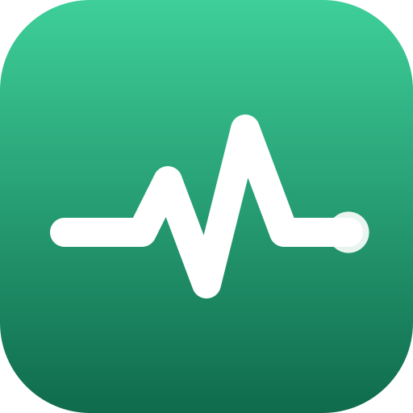

# HookPulse — skill and MCP server for AI agents



HookPulse tells you when a cron job, webhook, backup or scheduled GitHub Actions workflow stops running. Each
routine gets a check-in link. If the check-in does not arrive by the expected time, or the routine reports a
failure, HookPulse sends an alert by e-mail or to a webhook such as Slack or Discord, and it tells you when the
routine comes back. This repository packages the HookPulse skill and the connection to its remote MCP server for
Claude Code, Codex, Cursor and other agents.

**Site:** https://hookpulse.net · **MCP server:** `https://hookpulse.net/mcp?checkout=site` ·
**Prices:** https://hookpulse.net/pricing · **API docs:** https://hookpulse.net/developers

## What your agent can do

- Create a monitor for a routine, with an interval or a cron schedule, a time zone and an allowed delay.
- Import a crontab: see the proposed monitors first, then create them in one call.
- Give each run a start, a success or a failure signal, with the shell exit code.
- Instrument a whole fleet with one setup key: the first check-in of each name creates its monitor.
- Read the state of every monitor, the latest check-ins and the public status page.

Try: *"Import my crontab into HookPulse and show me what it would create."* or
*"Create a monitor for the nightly backup that runs at 03:00 São Paulo time."*

## GitHub Actions

A scheduled workflow gets a monitor with one step and no secret. The job's identity token tells HookPulse which
repository and workflow it is; the first run creates the monitor with the workflow's schedule:

```yaml
permissions:
  contents: read
  id-token: write
jobs:
  backup:
    runs-on: ubuntu-latest
    steps:
      - run: ./backup.sh
      - uses: wrpbr/hookpulse-action@v1
        if: always()
        with:
          status: ${{ job.status }}
```

See [wrpbr/hookpulse-action](https://github.com/wrpbr/hookpulse-action) for alerts and options. Without changing
any workflow, install the [HookPulse GitHub App](https://github.com/apps/hookpulse-actions-monitor): a missed or
failed scheduled run opens an issue in the repository, and the next good run closes it.

## Install

Claude Code, as a plugin with the skill and the MCP server:

```
/plugin marketplace add wrpbr/hookpulse
/plugin install hookpulse@hookpulse
```

Any agent that reads Agent Skills (Claude Code, Codex, Cursor, OpenCode and others):

```bash
npx skills add wrpbr/hookpulse
```

Only the MCP server (remote, Streamable HTTP, no key needed to start):

```bash
claude mcp add --transport http hookpulse 'https://hookpulse.net/mcp?checkout=site'   # Claude Code
codex mcp add hookpulse --url 'https://hookpulse.net/mcp?checkout=site'               # Codex
```

```json
{ "mcpServers": { "hookpulse": { "url": "https://hookpulse.net/mcp?checkout=site" } } }
```

The JSON above goes in `.cursor/mcp.json` for Cursor and in the MCP settings of most other clients. The GitHub
Copilot coding agent takes it in the repository settings, under Copilot → MCP servers, with `"type": "http"` and
the tools you allow.

## Price

Ten monitors are free, and check-ins have no charge. E-mail alerts on one monitor are free; e-mail alerts on each
additional monitor cost a one-time fee. Alerts to webhooks have no alert charge. You buy credit on the site, and
nothing renews automatically. The plugin never pays: with `checkout=site`, the MCP server has no purchase tool and
no payment argument. The current prices are at https://hookpulse.net/pricing.

## What the plugin sends

The skill tells the agent to call the HookPulse API at hookpulse.net. The MCP server also runs at hookpulse.net.
The names, schedules and alert destinations of your monitors go to hookpulse.net over HTTPS. The plugin runs no
local program and reads no local file; the crontab import reads only the text you paste.

## Em português

O HookPulse avisa quando uma rotina agendada, um webhook, um backup ou um workflow agendado do GitHub Actions para
de rodar. Cada rotina ganha um link de check-in; se ele não chega no horário, ou se a rotina avisa uma falha, o
alerta sai por e-mail ou por webhook. Este repositório traz a skill e a conexão com o servidor MCP remoto. Instale
com os comandos acima. Dez monitores são grátis. Os preços estão em https://hookpulse.net/pricing.

## Files

| File | What it is |
|---|---|
| `skills/hookpulse/SKILL.md` | The skill: which tool answers which question, and the rules for alerts and limits |
| `.mcp.json` | The remote MCP server of the plugin |
| `.claude-plugin/plugin.json` | The plugin manifest |
| `.claude-plugin/marketplace.json` | Lets Claude Code add this repository as a plugin marketplace |
| `server.json` | The manifest in the official MCP registry (`net.hookpulse/hookpulse`) |
| `glama.json` | The maintainer for the Glama MCP directory |

## License and contact

The files in this repository are under the MIT-0 license. The HookPulse service is not part of this license: its
use follows the [terms of use](https://hookpulse.net/terms) and the [privacy policy](https://hookpulse.net/privacy).
For questions or problems, open an issue here or write to contato@hookpulse.net.
